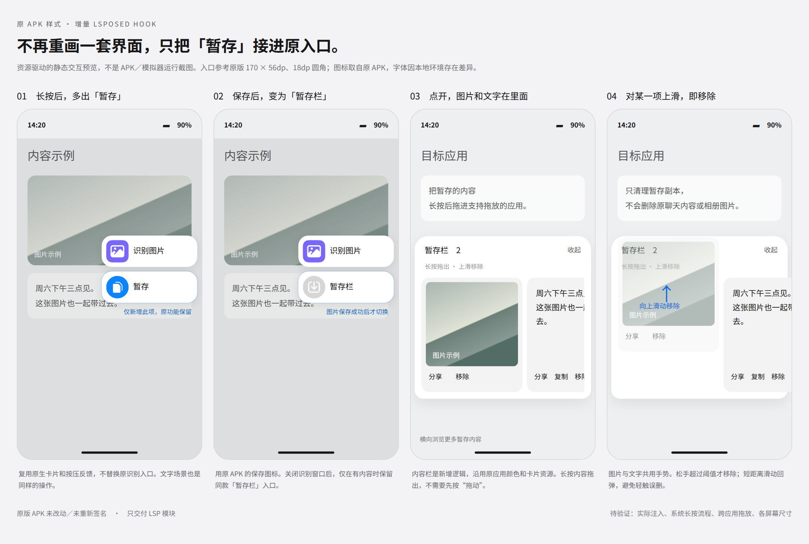

# 传送门暂存 · PortalStash

为 **澎湃 OS / HyperOS 传送门**（`com.miui.contentextension`）增加一个轻量“暂存栏”的 **LSPosed 模块**。

长按唤起传送门后，原有识别入口下方多出一个 **“暂存”**。点击保存当前识别到的文字或图片，入口随即变成保存图标与 **“暂存栏”**。暂存内容可以在目标应用里 **长按拖出**，也可以 **上滑移除**。

> 原版传送门 APK **不被修改、不被重签名、不被替换**。模块只通过 Hook 在原界面上增量添加功能。

<p align="center">
  
</p>

<p align="center"><sub>四步交互静态预览（0.3.0 界面）。由原 APK 资源与本地 Chromium 渲染生成，<b>不是实机运行截图</b>；0.4.0 新增的圆角、动效与玻璃未包含在此图中。</sub></p>

---

## 功能

### 暂存入口

- 复用传送门自带的卡片组件 `TaplusRecognitionShrinkCard`，沿用原布局、字体、文字颜色、圆角背景、图标与按压反馈。
- 原有“识别文字 / 识别图片”入口保持不变。
- 保存成功后，入口图标切换为原 APK 的保存图标，文案变为“暂存栏”。
- 展开的识别卡片底部也会增量添加“暂存”，便于保存已选中的分词。
- 关闭识别窗口后，仅在存在暂存内容时显示同款入口。

### 暂存栏

- 文字与图片 **横向排列**，可左右滑动浏览。
- **长按拖出**：通过 Android 跨应用拖放（`startDragAndDrop` + `ClipData`）拖到目标应用。
- **上滑移除**：松手超过阈值才移除，短距离滑动回弹，降低误触。
- 备用操作：分享（系统分享面板）、复制文字、移除。
- 图片以 PNG 保存到模块私有目录，通过受限 `ContentProvider` 提供带授权的最小 URI。

### 外观与动效（0.4.0）

- **完整圆角**：暂存栏四角、内容卡片与图片各自独立轮廓裁切，圆角可选 18 / 24 / 30 dp。
- **柔和弹簧动效**：展开入场、收起退场、暂存成功轻回弹、上滑移除与取消回弹。
- 动效可关闭，并遵循系统的“关闭动画”设置。

### 可选：澎湃 4 原生材质（实验）

- **暂存栏柔光玻璃**：默认关闭。调用系统 `View` 扩展接口（`setMiGlass`、`setMiViewMaterialType`、`setMiGlassBlurRadius` 等）并做能力检测；不可用时自动回退普通背景。
- **系统界面组件材质**：默认“跟随系统”，可选柔光玻璃 / 经典材质。仅 Hook `miui.systemui.util.MiBackgroundStyle.getMaterialMode()`，严格限定版本，不强制设备能力、不改系统设置、不碰系统桌面。

---

## 兼容性

| 项目 | 要求 |
| --- | --- |
| 传送门 | `com.miui.contentextension` **5.1.5**（versionCode `50015`），其他版本不会装载 Hook |
| 系统 | 澎湃 OS，Android 14+（模块 minSdk 28，targetSdk 35） |
| 框架 | 支持传统 Xposed API 的 LSPosed（模块声明 API 93+） |
| 系统组件材质（可选） | `miui.systemui.plugin` **18.3.2.22.0**（versionCode `183022200`），Android 36+ |
| Root | Magisk / KernelSU 等，需可用 LSPosed |

---

## 安装与启用

1. 安装 [Releases](https://github.com/iasmndjxjz/PortalStash/releases) 中的 APK（当前版本 `v0.4.0`，SHA256 `6075b5670a2624804ddcb5116c8f5c2910cf7451d64ded0f6872ab00778dce2c`）。
2. 在 LSPosed 中启用模块。
3. **基础暂存功能**：作用域只勾选 **传送门**（`com.miui.contentextension`）。
4. 若要使用“系统界面组件材质”，再额外勾选 `com.android.systemui` 与 `miui.systemui.plugin`（详见下文）。
5. 手动重启（或让传送门进程重新加载模块）。
6. 打开传送门长按识别，点“暂存”。

> 本模块不会自动结束系统应用，也不提供“一键重启”按钮。首次加载或升级后需要你手动重启。

### 系统组件材质的作用域说明

系统界面组件通常运行在 SystemUI 的独立 ClassLoader 中，因此仅勾选传送门不会影响它。启用该实验功能需要额外勾选：

- `com.android.systemui`
- `miui.systemui.plugin`

模块会在 45 秒的有限观察窗口内等待目标类加载，未出现即停止监听，不会长期拦截所有类加载。版本不匹配时直接跳过并写日志。

---

## 设置项

| 设置 | 默认 | 说明 |
| --- | --- | --- |
| 暂存侧栏 | 开 | 关闭后隐藏入口与暂存栏（已有内容不删除） |
| 保存时长 | 1 小时 | 15 分钟 / 1 小时 / 6 小时 |
| 暂存上限 | 12 条 | 6 / 12 / 24；调低不会立刻删除已有内容 |
| 入口位置 | 右侧 | 左 / 右 |
| 内容圆角 | 24 dp | 18 / 24 / 30 |
| 原生平移动画 | 开 | 遵循系统动画开关 |
| 暂存栏原生柔光玻璃 | 关 | 实验，失败回退普通背景 |
| 组件材质 | 跟随系统 | 柔光玻璃 / 经典；仅限指定版本 |
| 设置页主题 | 跟随系统 | 仅影响模块设置页 |

设置通过受限 `ContentProvider` 与 `ContentObserver` 同步到已注入进程，**修改设置不需要重启手机**。系统组件的材质变更通常在视图重新创建后生效，不承诺立即重绘已有面板。

---

## 隐私与数据

- **不读取**通知、短信、聊天数据库、相册或剪贴板内容。
- **不自动发送**任何消息；分享与拖放目标始终由你选择。
- 文字列表保存在传送门进程的私有 `SharedPreferences`；图片保存在模块私有目录。
- 模块无联网权限、无上传逻辑。
- 日志只记录阶段与异常类型，不记录识别正文、文件路径或 URI。
- 图片缓存：单张不超过 1200 万像素；异步缩略图最长边 640 px；插入时按 24 小时 / 32 张 / 128 MiB 做清理。
- 锁屏时隐藏；过期清理在进程运行或下次启动时执行，**不是后台精确定时擦除**。
- “清空暂存”会删除图片缓存，并通过清空标记通知在线进程；离线文字列表在下次载入时清空。

系统组件材质开关只通过一个**仅含模式整数**的独立 Provider 方法同步，系统进程无法读取暂存正文或图片缓存。

---

## 已知限制与验证状态

0.4.0 已完成本地编译、签名校验与纯 JVM 数值检查，并已由维护者在澎湃 OS 4 真机上安装、注入，验证了基础流程：长按入口、暂存保存、暂存栏展示、拖出与上滑移除。

以下项目仍未做系统性测量，效果取决于机型与系统版本：圆角与动效的实际观感、动画帧率、原生玻璃是否真正显示、系统界面组件材质的实际表现。

逐项记录见 [构建与验证记录](docs/BUILD-AND-VERIFICATION.md)。

- 跨应用拖放依赖目标应用支持 `DragEvent`、`ClipData` 与 URI 读取授权。微信、QQ、网页或任意输入框不保证可用，失败时请用系统分享。
- 外部图片直接拖入未实现；图片须先经传送门识别。
- 长按拖出与上滑移除通过方向、距离、长按时间区分，阈值仍需真机调校。
- 原生玻璃接口可能“调用成功但不显示玻璃”——接口可用不等于视觉生效。
- 与 HyperLight 等针对同一组件的材质模块同时启用可能冲突。
- 未测试横竖屏、折叠屏、多用户、锁屏恢复、不同 LSPosed 分支。
- 系统回收服务后，暂存内容会在下次唤起时尝试恢复。

出现异常：在 LSPosed 中停用模块，手动重启。原版 APK 未被修改。

---

## 构建

需要 JDK 21、curl、zip、`aapt`、`zipalign`、`apksigner`。

```bash
bash prepare-tools.sh   # 下载并校验编译桩与工具
bash build.sh           # 编译、打包、签名
```

- `tools/android-35.jar` 用于 javac / D8；`tools/android-28-res.jar` 供旧版 aapt 读取资源表（targetSdk 仍为 35）。
- 传统 Xposed API 82 仅作 compile-only，不会打进 APK。
- 首次构建会生成本地实验签名；自行构建的签名与 Release 不同，不能直接覆盖安装。

### 无 Android 设备的纯 JVM 检查

```bash
javac --release 8 -cp build/classes:tools/android-35.jar \
  -d build/tests tests/stubs/android/net/Uri.java tests/io/github/portalstash/ConfigTest.java
java -cp build/tests:build/classes:tools/android-35.jar io.github.portalstash.ConfigTest
```

覆盖设置默认值/白名单、圆角与材质模式校验、弹簧数值稳定性。`tests/stubs` 仅用于避开 Android 静态初始化，不模拟渲染、权限或 Hook 行为。

---

## 项目结构

```
src/io/github/portalstash/
  HookEntry.java         Xposed 入口，版本校验与 Hook 安装
  StashController.java   暂存状态、浮窗、手势、拖放与分享
  NativePortalUi.java    复用原 APK 组件与资源
  Motion.java            与传送门一致的平移动效与圆角裁切
  GlassCompat.java       系统 View 玻璃扩展的能力检测与回退
  SystemPluginHook.java  限定版本的系统组件材质选择 Hook
  Config.java            设置持久化与白名单
  StashProvider.java     受限图片缓存与设置同步
  InfoActivity.java      模块设置页
  MiuixStyle.java        设置页的轻量样式
  VisualMath.java        几何与弹簧数学
res/ assets/             图标、Xposed 入口与作用域声明
tests/                   纯 JVM 检查
```

## Hook 点

| 目标 | 用途 |
| --- | --- |
| `App.onCreate()` | 版本校验后初始化 |
| `TaplusSplashFloatView.initRecognitionCards()` | 在原生长按入口旁增量添加“暂存” |
| `TaplusMainFloatView.showMainFloat(boolean)` | 展开卡片内增量添加暂存操作 |
| `TextContentExtensionService.getBitmap()` / `sContent` / `isTextMode()` | 读取用户主动识别的结果 |
| `TaplusRecognitionExpandedCard.isCurrentInTextMode()`、`TaplusSegmentAdapter.getSelectedWords()` | 当前模式与选中的分词 |
| `TextContentExtensionService.scheduleStopSelfJob()` / `onDestroy()` | 暂存期间维持服务生命周期 |
| `miui.systemui.util.MiBackgroundStyle.getMaterialMode()` | 可选的系统组件材质选择（默认不覆盖） |

---

## English

**PortalStash** is an LSPosed module that adds a lightweight stash bar to the HyperOS "Portal" (`com.miui.contentextension` 5.1.5). After a long-press recognition, a native-styled **Stash** action appears; saving changes it into **Stash bar**. Items can be dragged into other apps or swiped up to remove. The vendor APK is never modified or re-signed.

Version 0.4.0 adds full outline clipping, spring-based motion, optional native glass on the stash surface, and a version-locked experimental hook for the System UI plug-in's material selector. **It has not been verified on a real device yet.**

---

## 许可证

本项目以 [MIT License](LICENSE) 开源。

## 免责声明

本项目仅供学习与个人使用。使用前请自行评估风险；因使用本模块导致的系统异常、数据丢失或保修问题由使用者自行承担。与小米、HyperOS、LSPosed 官方无关联。
